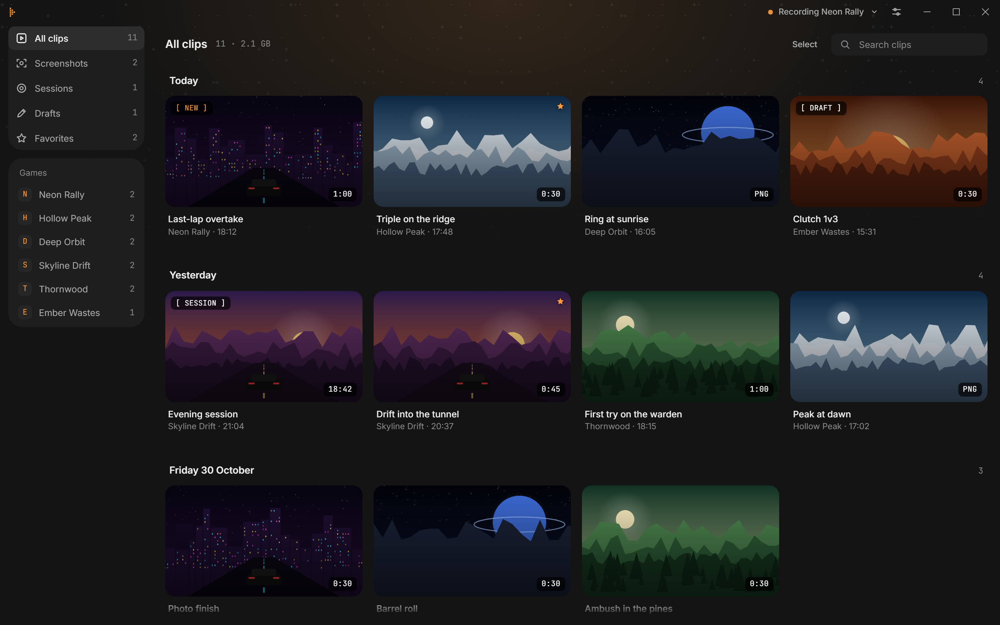
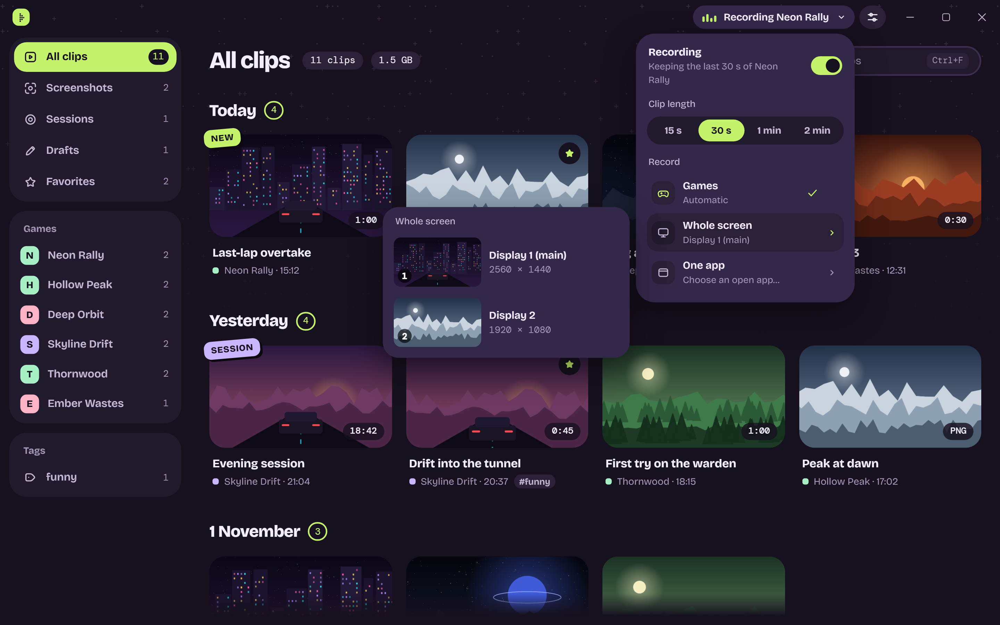
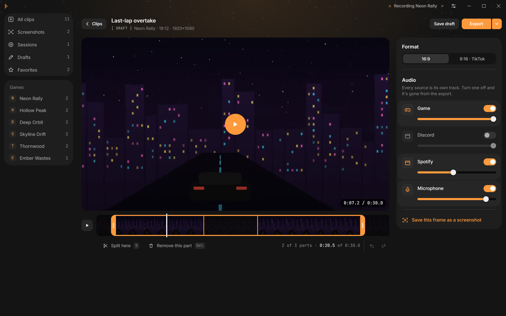
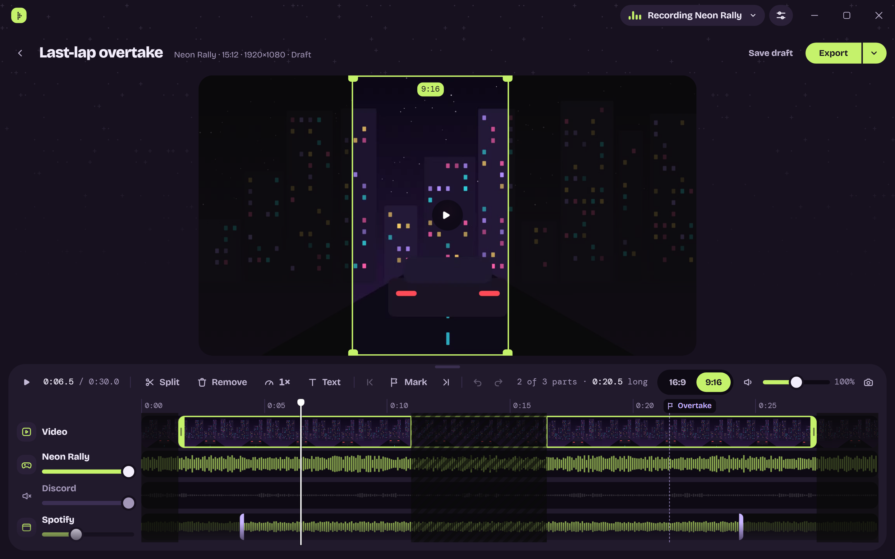
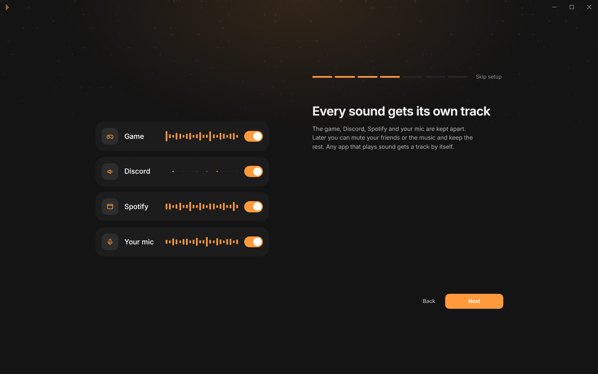
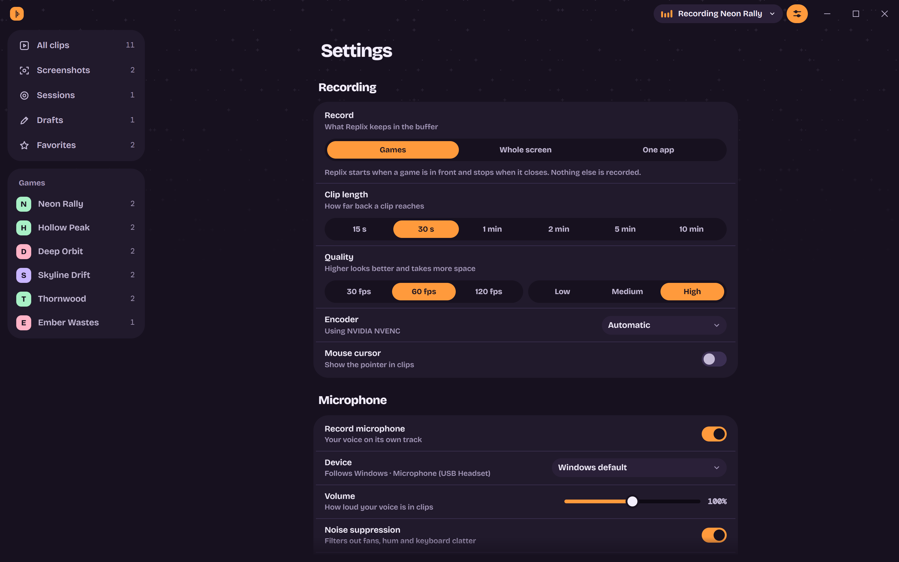

# Replix

**Never miss the moment.** Replix quietly keeps the last seconds of your game. Press <kbd>Alt</kbd> + <kbd>C</kbd> and they're saved as a clip, with every sound on its own track.

**[Download](https://github.com/Mailo037/Replix/releases/latest)** · Windows 10 and 11 · Linux · macOS 11 or newer · 64-bit · Free

## Keep what just happened

Replix starts on its own when a game is in front and keeps a rolling buffer, from 15 seconds up to 10 minutes. Nothing to start, nothing to stop. When something great happens, press the key; the game keeps running, a soft sound and a small note in the corner tell you it's saved.

Instead of games, Replix can also watch the whole screen or a single app. For longer stretches, start a session and it records until you press the key again. A session is written into your clips folder while it runs, so a crash or a power cut does not cost the recording: the next time Replix starts, it turns up in the library. The library shows a session that is being recorded, with its time and a button to stop it. Press <kbd>Alt</kbd> + <kbd>M</kbd> while recording to mark a moment; the editor shows every marker on the timeline and jumps from one to the next.

## Every sound on its own track

The game, Discord, Spotify and your microphone are kept apart. Mute your friends or turn the music down later, and keep the rest. Any app that plays sound gets a track of its own.

Pick your microphone, check that it's picking you up, and let noise suppression filter out fans, hum and keyboard clatter.

## Edit in seconds

Trim the start and end, split the clip and take out the parts you don't need. Turn tracks off or down, let a track play for only part of the clip, or save one on its own as audio. Then export in full quality, small enough for Discord, or as a GIF. <kbd>Ctrl</kbd> + <kbd>Z</kbd> takes any step back.

Switch to 9:16 for TikTok, Shorts and Reels, and drag the frame to where the action is. Pull a corner to zoom in.

For a video editor, export **Separate tracks**: an MKV with the mix first and then every track on its own, with its name.

## Share it

Copy a clip and paste it straight into Discord or a chat, drag it out of the library, or get a link that works for 72 hours. Screenshots open in a viewer you can zoom into.

## Find it again

Give clips tags like *win* or *funny*, one at a time from a clip's menu or for a whole selection at once. Every tag gets a place in the sidebar, and searching for `#win` finds the clips that wear it.

## Bring in what you already have

Import videos and pictures with the button in the library, or drop files and folders onto the window. Replix copies them into an *Imported* folder and leaves the originals where they were.

## Set it up once

A short setup walks you through the clip length, what to record, the tracks and your microphone.

Every game can have its own clip length, frame rate, quality and microphone setting, or be left out entirely. A space limit moves the oldest clips to the recycle bin (the Trash on Linux and macOS); favorites, drafts and imported videos stay.

Under **Privacy**, keep programs like a password manager or a private chat out of every recording: they never count as a game, their sound gets no track, and on the whole screen their visible areas turn black. Opaque windows in front stay visible instead of being blacked out with the private window behind them. Transparent overlays do not count as covers, since private content can show through them. Around window changes, short safety margins can hide a little more to keep private content out.

Replix speaks English, Deutsch, Español, Français, Italiano, Português, Polski, Русский, Türkçe, 日本語, 한국어 and 简体中文, and follows the system's language unless you pick one.

## Keys

| Key | What it does |
| --- | --- |
| <kbd>Alt</kbd> + <kbd>C</kbd> | Save the last moments as a clip |
| <kbd>Alt</kbd> + <kbd>S</kbd> | Screenshot |
| <kbd>Alt</kbd> + <kbd>X</kbd> | Start or stop a session |
| <kbd>Alt</kbd> + <kbd>M</kbd> | Mark a moment |

All four can be changed in Settings, which tells you right away if another program already uses a key. In the editor: <kbd>Space</kbd> plays, <kbd>S</kbd> splits, <kbd>Del</kbd> removes a part, <kbd>I</kbd> and <kbd>O</kbd> set the start and end, <kbd>M</kbd> sets a marker, <kbd>,</kbd> and <kbd>.</kbd> jump between markers.

## Your clips stay yours

Everything is recorded and kept on your computer, in `Videos\Replix` (`~/Videos/Replix` on Linux, `~/Movies/Replix` on macOS) unless you choose another folder. Nothing is uploaded unless you click **Get a link**, which sends that one clip to [Litterbox](https://litterbox.catbox.moe) for 72 hours. Replix checks GitHub for new versions and updates itself.

## Good to know

- Recording uses your graphics card's video encoder (NVIDIA, AMD or Intel) and falls back to the processor when there is none. The bitrate follows what you record: a 1440p game at 120 fps gets more than a 1080p one at 30.
- Where the graphics card can, clips can be recorded in HEVC, which needs about half the space. Exports are always H.264, so they play everywhere.
- Replix waits in the tray (the menu bar on macOS) and can start when you log in.

## Linux and macOS

Replix runs on all three systems. Windows has everything above; on the others a few things depend on what the system allows.

| | Windows | Linux | macOS |
| --- | --- | --- | --- |
| FFmpeg | downloaded by Replix | from your package manager: `sudo apt install ffmpeg` (or dnf, pacman) | from Homebrew: `brew install ffmpeg` |
| Games, one app | yes | X11, and games under XWayland on Wayland (most games, Proton too) | yes, recorded as the display the game is on |
| Whole screen | yes | X11 session | yes, after allowing *Screen Recording* |
| Private windows | visible areas are blacked out; opaque windows in front stay visible | same, on X11 | same, including app captures recorded as a display |
| A track per app | yes | yes, through PulseAudio or PipeWire (`pulseaudio-utils`) | no: the microphone, plus all system sound when a loopback device like [BlackHole](https://existential.audio/blackhole/) is installed |
| Video encoder | NVIDIA, AMD, Intel, processor | NVIDIA, VA-API (AMD, Intel), processor | VideoToolbox, processor |
| HEVC recording | NVIDIA, AMD, Intel | NVIDIA, VA-API, if the system can play HEVC (GStreamer's `gst-libav`) | VideoToolbox |
| Copy a clip | yes | with `wl-clipboard` or `xclip` | yes |
| Hotkeys | yes | X11 | yes |

On macOS the app is not notarized, so the first start is blocked once. Open it, close the message, then go to *System Settings* › *Privacy & Security*, scroll down and click **Open Anyway** next to Replix. On macOS 14 and older, right-click the app › **Open** does the same.

Replix uses [FFmpeg](https://ffmpeg.org), licensed under the GPL v3, and downloads it on first start. Its source is available at [ffmpeg.org](https://ffmpeg.org/download.html).
